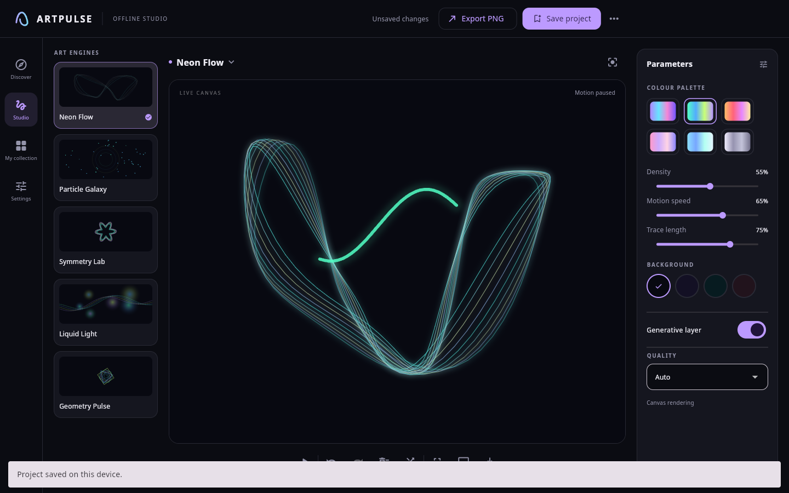

# DOKUNYA

An offline generative art instrument built with Flutter and Dart. Draw with touch, a stylus or a mouse; shape a live composition, save an editable project and export the art as PNG. Free and open source under MIT.



## What works in 0.1.0

- **Neon Flow:** evolving light ribbons plus pressure/speed-sensitive strokes.
- **Particle Galaxy:** bounded particles, softened attraction and gesture bursts.
- **Symmetry Lab:** 2, 4, 6, 8 or 12 radial copies of your marks.
- **Liquid Light:** interactive colour fields, optional GLSL and a Canvas fallback.
- **Geometry Pulse:** evolving polygons and gesture-centred shapes.
- Ten starting presets, six palettes, four backgrounds, density/speed/trail controls.
- Local collection, versioned editable JSON import/export, PNG export and stroke undo/redo.
- Compact, tablet and desktop layouts; mouse, keyboard, multi-touch and stylus input.
- English, Turkish and Azerbaijani, reduced motion and experimental TV/ambient layouts.
- No account, backend, telemetry, advertising or paid service.

This is the DOKUNYA v0.1.2+3 source rebrand of the existing ARTPULSE v0.1.0 → RENIZ v0.1.1 development codebase. The renamed source has not yet been built on the target platforms. The Android application ID and iOS/macOS bundle identifier are deliberately unchanged, and the original local storage paths remain, so previous projects remain addressable. Existing APKs remain ARTPULSE-branded until a new build is completed. A matching signing key is required for in-place Android updates. [Platform support](docs/PLATFORM_SUPPORT.md) and [test evidence](docs/TEST_REPORT.md) distinguish compiled targets, automated tests and hardware that has not been tested. No installable iPhone IPA or Windows EXE is claimed unless such a build actually exists.

## Run the source

Install Flutter **3.50.0** with its bundled Dart **3.14.0**, and the toolchain for your target. Then:

```sh
flutter pub get
flutter run -d chrome --no-web-resources-cdn
# Or choose a connected Android device / native desktop from flutter devices.
```

If the SDK archive cannot be downloaded in your environment, the official tagged source also works:

```sh
git clone --depth 1 --branch 3.50.0 https://github.com/flutter/flutter.git flutter-sdk
# Add flutter-sdk/bin to PATH, then run flutter --version to bootstrap bundled tools.
```

For an automated environment, set `CI=true` and `FLUTTER_SUPPRESS_ANALYTICS=true` before starting Flutter. The CI setting prevents Flutter's cloud-instance detection probe; the second disables tool analytics. These are build-environment settings, not application data collection.

## Build

| Target | Command | Host requirement |
| --- | --- | --- |
| Android | `flutter build apk --release` | Android SDK 36, NDK selected by Flutter, complete JDK 17+ |
| Web | `flutter build web --release --no-web-resources-cdn` then `python3 tool/prepare_web.py` | Flutter web tools |
| Windows | `flutter build windows --release` | Windows + Visual Studio C++ desktop workload |
| Linux | `flutter build linux --release` | Clang, CMake, Ninja, pkg-config, GTK 3 development libraries |
| macOS | `flutter build macos --release` | macOS + Xcode; signing/notarization are separate |
| iOS Simulator | `flutter build ios --simulator --debug --no-codesign` | macOS + Xcode; this is not an iPhone IPA |
| Android TV source | `flutter run --dart-define=DOKUNYA_TV=true` | Android TV target and remote/device verification |

The Android release configuration deliberately uses a **development signing certificate** for initial sideload testing. Configure a privately held release key before store distribution or long-term updates. No keystore or certificate is included in source control.

Serve the compiled web folder through HTTP/HTTPS, rather than opening index.html as a `file:` URL:

```sh
python3 -m http.server 8080 --directory build/web
```

The custom PWA worker caches the exact built assets. Offline installation requires HTTPS or localhost. Offline reload needs one successful online load and completed worker installation. Browser storage may be cleared or quota-limited; download JSON backups of important projects. CanvasKit and fonts are local to the build.

## Controls

One pointer draws; two fingers zoom/pan. On desktop, use the wheel to pan, Ctrl/Cmd + wheel to zoom, and middle-drag to pan. `0` resets the viewport. The focus button expands the canvas and requests native/browser fullscreen where supported.

| Shortcut | Action |
| --- | --- |
| Space | Pause / resume motion |
| F / Escape | Enter / leave focus mode |
| C | Clear the canvas |
| R | New seeded variation |
| Ctrl/Cmd + S | Save an editable local project |
| Ctrl/Cmd + Z | Undo a stroke |
| Ctrl/Cmd + Shift + Z | Redo a stroke |

On mobile, PNG and JSON exports use the OS share sheet; select a save destination offered by the OS. Desktop uses a native file chooser. Web starts a file download. Saving a project in the collection is independent of exporting a file.

## Validate

```sh
flutter pub get
dart format --output=none --set-exit-if-changed .
flutter analyze
flutter test
python3 tool/license_audit.py
dart compile exe tool/benchmark.dart -o build/dokunya-benchmark
```

A real-storage integration test is supplied for a compatible device/runner:

```sh
flutter test integration_test/studio_flow_test.dart -d <device-id>
```

Golden baselines cover seven layouts. They are automated Flutter engine renders, not physical-device photographs. Use `flutter test --update-goldens` only after reviewing the intended visual differences.

## Architecture and publication

The bounded simulation is Dart code under `lib/core/graphics`; platform storage and export are adapters. See [architecture](docs/ARCHITECTURE.md), [research](docs/RESEARCH.md), [performance](docs/PERFORMANCE.md) and [third-party notices](THIRD_PARTY_NOTICES.md).

The included GitHub workflows analyze, test and build on matching operating systems. Tagged releases publish only after the build matrix passes. The Pages workflow is manually invoked after enabling GitHub Pages with Actions as its source; it builds with the repository subpath. These workflows are configuration until an actual GitHub run proves their results.

Tizen, webOS and tvOS have researched port plans, not delivered packages. GIF/video export, layers, a timeline, OS live wallpapers, thermal sensors and dynamic raster-resolution scaling are outside this first release.

See [CONTRIBUTING.md](CONTRIBUTING.md), [SECURITY.md](SECURITY.md) and [CODE_OF_CONDUCT.md](CODE_OF_CONDUCT.md). Original application code is [MIT](LICENSE); third-party notices are retained separately. DOKUNYA is an approved proposed name formed from Turkish *dokun* (touch) and *dünya* (world). Name checks are preliminary and do not provide trademark clearance.

Optional browser QA uses Playwright 1.62.1: install it as a development tool and run `node tool/web_smoke.cjs build/web`. Set `CHROME_EXECUTABLE` to an available Chromium/headless-shell executable when needed. This exercises actual browser storage, downloads and offline reload; it is not part of the app's runtime dependencies.

## Safe rename and backward compatibility

See [DOKUNYA rename and migration notes](docs/DOKUNYA_RENAME_TR.md). Old `.artpulse.json` and `.reniz.json` exports can still be imported; new exports use `.dokunya.json`. The earlier `docs/evidence` and historical platform/test reports describe **ARTPULSE v0.1.0**, not newly-run DOKUNYA tests.
